<p align="center">
    <b><code style="color : gold">Zeen's Kanban Board</code></b>
    <br/><br/>
    A small C-based Kanban board service for practicing operating-systems concepts, including TCP sockets, process synchronization, shared memory, file persistence, and pthread-based parallel search. The interactive client is written in <b>Fish shell</b>. Also come with a generate fake data script for testing!
  </br></br>
</p>

## Contents

- [Requirements and installation](#requirements-and-installation)
- [Project structure](#project-structure)
- [Build and run](#build-and-run)
- [Interactive Fish client](#interactive-fish-client)
- [Features and parallel programming](#features-and-parallel-programming)
- [TCP protocol](#tcp-protocol)
- [Data files](#data-files)
- [Generate fake data](#generate-fake-data)
- [Tests](#tests)

## Requirements and installation

The project is intended for a modern Linux distribution with POSIX threads and process support. It uses:

- `clang` to compile the server and C tests.
- `fish` to run the supplied server, test, and interactive-client scripts. These scripts use Fish syntax and are **not Bash scripts**.
- `ncat` to connect the Fish client to the TCP server.
- `fuser` (provided by `psmisc`) to stop an existing process listening on port `3030` before starting the server.
- `python3` to generate fake board and task data.
- POSIX threads and semaphores from the system C library/toolchain. No separate pthread package is required on standard Linux installations.

### Ubuntu / Debian-based distributions

Run this single command to install the required tools:

```bash
sudo apt update && sudo apt install -y clang fish nmap psmisc python3
```

`nmap` provides `ncat`.

### Arch Linux

```bash
sudo pacman -Syu --needed clang fish nmap psmisc python
```

`nmap` provides `ncat`; the `python` package provides Python 3.

> These commands install system packages and require `sudo` (or root access). If your distribution separates `ncat` into a different package, install the package that provides the `ncat` executable. Please do not use GNU `nc` there is a bug.

## Project structure

You can have a quick observation of the project here:

### Functions overview

[](https://gitdiagram.com/rouempire/cos3105_project?utm_source=readme&utm_medium=picture)

### Architecture diagram

```mermaid
%% Generated by https://gitdiagram.com/rouempire/cos3105_project
flowchart TD

subgraph group_client["Interactive client"]
  node_fish["Fish client<br/>[app.fish]"]
  node_generator["Fake data generator"]
end

subgraph group_server["TCP service"]
  node_server["TCP server<br/>[server.c]"]
  node_protocol["Command protocol<br/>[protocol.h]"]
end

subgraph group_features["Board and task features"]
  node_addboard["Add board<br/>[add_board.c]"]
  node_addtask["Add task<br/>[add_task.c]"]
  node_getboard["Board lookup<br/>[get_board.c]"]
  node_gettask["Task lookup<br/>[get_task.c]"]
  node_updateboard["Update board<br/>[update_board.c]"]
  node_updatetask["Update task<br/>[update_task.c]"]
  node_removeboard["Delete board<br/>[remove_board.c]"]
  node_removetask["Delete task<br/>[remove_task.c]"]
  node_status["Task status<br/>[set_task_status.c]"]
  node_bulk["Bulk retrieval<br/>[get_all_data.c]"]
end

subgraph group_runtime["State and concurrency"]
  node_models[("Board/task state<br/>[models.c]")]
  node_common["Shared helpers<br/>[common.c]"]
end

node_user(("User"))
node_tcp(("TCP connection"))

node_user -->|"uses"| node_fish
node_fish -->|"sends commands"| node_tcp
node_tcp -->|"connects"| node_server
node_server -->|"dispatches commands"| node_protocol
node_server -->|"routes to"| node_addboard
node_server -->|"routes to"| node_addtask
node_server -->|"routes to"| node_getboard
node_server -->|"routes to"| node_gettask
node_server -->|"routes to"| node_bulk
node_server -->|"routes to"| node_updateboard
node_server -->|"routes to"| node_updatetask
node_server -->|"routes to"| node_removeboard
node_server -->|"routes to"| node_removetask
node_server -->|"routes to"| node_status
node_server -->|"loads state"| node_models
node_models -->|"uses helpers"| node_common
node_addtask -->|"looks up board"| node_getboard
node_addtask -->|"checks duplicates"| node_gettask
node_updateboard -->|"finds board"| node_getboard
node_updatetask -->|"finds board"| node_getboard
node_updatetask -->|"finds task"| node_gettask
node_removeboard -->|"finds board"| node_getboard
node_removetask -->|"finds board"| node_getboard
node_removetask -->|"finds task"| node_gettask
node_status -->|"finds board"| node_getboard
node_status -->|"finds task"| node_gettask
node_fish -.->|"offers generation"| node_generator
node_server -.->|"persists updates"| node_models

click node_fish "https://github.com/rouempire/cos3105_project/blob/main/frontend/app.fish"
click node_server "https://github.com/rouempire/cos3105_project/blob/main/src/server.c"
click node_protocol "https://github.com/rouempire/cos3105_project/blob/main/src/protocol.h"
click node_addboard "https://github.com/rouempire/cos3105_project/blob/main/src/features/add_board.c"
click node_addtask "https://github.com/rouempire/cos3105_project/blob/main/src/features/add_task.c"
click node_getboard "https://github.com/rouempire/cos3105_project/blob/main/src/features/get_board.c"
click node_gettask "https://github.com/rouempire/cos3105_project/blob/main/src/features/get_task.c"
click node_updateboard "https://github.com/rouempire/cos3105_project/blob/main/src/features/update_board.c"
click node_updatetask "https://github.com/rouempire/cos3105_project/blob/main/src/features/update_task.c"
click node_removeboard "https://github.com/rouempire/cos3105_project/blob/main/src/features/remove_board.c"
click node_removetask "https://github.com/rouempire/cos3105_project/blob/main/src/features/remove_task.c"
click node_status "https://github.com/rouempire/cos3105_project/blob/main/src/features/set_task_status.c"
click node_bulk "https://github.com/rouempire/cos3105_project/blob/main/src/features/get_all_data.c"
click node_models "https://github.com/rouempire/cos3105_project/blob/main/src/models.c"
click node_common "https://github.com/rouempire/cos3105_project/blob/main/src/common.c"
click node_generator "https://github.com/rouempire/cos3105_project/blob/main/generate_fake_data.py"

classDef toneNeutral fill:#f8fafc,stroke:#334155,stroke-width:1.5px,color:#0f172a
classDef toneBlue fill:#dbeafe,stroke:#2563eb,stroke-width:1.5px,color:#172554
classDef toneAmber fill:#fef3c7,stroke:#d97706,stroke-width:1.5px,color:#78350f
classDef toneMint fill:#dcfce7,stroke:#16a34a,stroke-width:1.5px,color:#14532d
classDef toneRose fill:#ffe4e6,stroke:#e11d48,stroke-width:1.5px,color:#881337
classDef toneIndigo fill:#e0e7ff,stroke:#4f46e5,stroke-width:1.5px,color:#312e81
classDef toneTeal fill:#ccfbf1,stroke:#0f766e,stroke-width:1.5px,color:#134e4a
class node_fish,node_generator,node_user toneBlue
class node_server,node_protocol toneAmber
class node_addboard,node_addtask,node_getboard,node_gettask,node_updateboard,node_updatetask,node_removeboard,node_removetask,node_status,node_bulk toneMint
class node_models,node_common toneRose
class node_tcp toneIndigo
```



```text
.
├── frontend/
│   └── app.fish                 Interactive Fish menu/client
├── src/
│   ├── features/                Command handlers and board/task search
│   ├── tests/                   C test programs
│   │
│   ├── common.c, common.h       Shared helpers
│   ├── models.c, models.h       Data structures and file persistence
│   ├── protocol.h               Command names and response status codes
│   ├── server.c, server.h       TCP server and command dispatch
├── tests/                         Testing suite
├── generate_fake_data.py        Board/task dataset generator
├── run_server.sh                Compile and launch the server (Fish script)
├── run_test.sh                  Compile and run a C test (Fish script)
├── board.txt                    Runtime board storage (git-ignored)
└── task.txt                     Runtime task storage (git-ignored)
```

The shell scripts have `.sh` filenames for convenience, but their shebang and syntax are Fish. Run them with `fish` or execute them directly if Fish is installed and the executable bit is set. Do not run them with `bash`.

## Build and run

Run the server from the project root:

```fish
./run_server.sh
```

The script stops any process listening on port `3030`, compiles `src/server.c`, the model/common sources, and all feature sources with `clang`, then starts the server on `127.0.0.1:3030`. Keep this terminal open while using the client.

Start the interactive client in another terminal, also from the project root:

```fish
fish frontend/app.fish
```

The client changes to the project root itself, so it can also be launched from its directory with `fish app.fish`.

To compile the server manually without starting it:

```bash
clang -I./src src/server.c src/models.c src/common.c src/features/*.c -o run_server -lpthread -lrt
```

**IMPORTANT**
> If a client reports `UNKNOWN,3` for a command that exists in this README, stop the currently running server and start it again with `./run_server.sh` so the latest command table is compiled and loaded.

## Interactive Fish client

Append `--status` or `-s` to a menu choice to display the protocol status codes for that action without running it. For example, enter `5 --status` (or `5 -s`) to see the possible responses for Update Board.

The Fish menu offers:

| Option | Action |
| --- | --- |
| `1` | Get a board by ID |
| `2` | Get one task or list tasks for a board |
| `3` | Add a board |
| `4` | Add a task |
| `5` | Update a board title |
| `6` | Update a task title |
| `7` | Generate fake data |
| `8` | Soft-delete a board by ID |
| `9` | Soft-delete a task using board ID and task ID |
| `ALL` | Fetch all board/task data |
| `T` | Run the interactive test suite |
| `X` | Exit |

The Fish client sends protocol lines over TCP using `ncat`, for example `DELETE_TASK,1,2`. It prints a message for successful responses and common errors, including invalid arguments and missing boards/tasks.

## Features and parallel programming

- **TCP command server:** accepts comma-separated commands on port `3030`. The server forks a child process to serve a client connection.
- **Shared project state:** board data is placed in shared memory so the forked server processes can work with the same project data.
- **Inter-process synchronization:** the server uses a named POSIX semaphore (`/store_lock`) to coordinate updates and persistence between processes. This protects critical sections that modify shared data and save files.
- **Adaptive board and task lookup:** board/task searches are sequential for fewer than 100 entries. At 100 or more entries, the search is partitioned into ranges and searched by pthread workers. Each worker searches its own range; the caller joins the workers and gathers the matching result.
- **Bulk retrieval thread pool:** the `GET_ALL` / `GET_ALL_DATA` feature uses a bounded pool of worker threads and a synchronized queue to load task data for boards.
- **Soft deletion:** deleting a board or task keeps its array slot as a tombstone rather than shifting later IDs. Deleted items are omitted from normal lookups and task lists.

The pthread-based search demonstrates data parallelism: independent ranges can be examined concurrently. The semaphore solves a different problem: coordinating writes between separate processes so shared state and files are not updated concurrently.

## TCP protocol

Each request is one line with comma-separated fields. Connect to `127.0.0.1:3030` using the Fish client or a TCP tool such as `ncat`:

```bash
echo 'GET_BOARD,1' | ncat -w 2 127.0.0.1 3030
```

### Commands

| Command | Arguments | Purpose |
| --- | --- | --- |
| `ADD_BOARD` | `<title>` | Create a board |
| `GET_BOARD` | `<boardId>` | Get one board |
| `GET_BOARDS` | `<boardId>` | Alias for `GET_BOARD` |
| `UPDATE_BOARD` | `<boardId>,<newTitle>` | Change a board title |
| `DELETE_BOARD` | `<boardId>` | Soft-delete a board |
| `ADD_TASK` | `<boardId>,<title>` | Add a task to a board |
| `GET_TASK` | `<boardId>,<taskId>` | Get one task |
| `GET_TASKS` | `<boardId>` | List tasks for a board |
| `UPDATE_TASK` | `<boardId>,<taskId>,<newTitle>` | Change a task title |
| `DELETE_TASK` | `<boardId>,<taskId>` | Soft-delete a task |
| `SET_TASK_STATUS` | `<boardId>,<taskId>` | Toggle task completion status |
| `GET_ALL` | `<boardLimit>,<taskLimit>` (both optional; `0` or omitted means no limit) | Fetch boards and their tasks |
| `GET_ALL_DATA` | `<boardLimit>,<taskLimit>` (both optional; `0` or omitted means no limit) | Alias for `GET_ALL` |

`GET_ALL` streams a response containing a board-count header, one record for each board and its tasks, and an `END_ALL` trailer. For example, `GET_ALL,10,20` requests at most 10 boards and 20 tasks per board.

Examples:

```bash
# Create a board
echo 'ADD_BOARD,Board 1' | ncat -w 2 127.0.0.1 3030

# Create a task in board 1
echo 'ADD_TASK,1,Write tests' | ncat -w 2 127.0.0.1 3030

# Soft-delete task 2 from board 1
echo 'DELETE_TASK,1,2' | ncat -w 2 127.0.0.1 3030
```

Responses are comma-separated and begin with the command name and a status code. Common status codes (defined in `src/protocol.h`):

| Code | Meaning |
| ---: | --- |
| `0` | `STATUS_OK` |
| `1` | `STATUS_FAIL` |
| `3` | `STATUS_UNKNOWN` (unrecognized command) |
| `200` | `STATUS_INVALID_ARGUMENTS` |
| `201` | `STATUS_BOARD_NOT_FOUND` |
| `202` | `STATUS_EMPTY_BOARD` |
| `203` | `STATUS_TASK_NOT_FOUND` |
| `204` | `STATUS_EMPTY_TASK` |
| `500` | `STATUS_SAVE_BOARD_FAIL` |
| `501` | `STATUS_ADD_BOARD_FAIL` |
| `502` | `STATUS_SAVE_TASK_FAIL` |
| `503` | `STATUS_ADD_TASK_FAIL` |

Examples: `ADD_BOARD,0` means the board was created. `DELETE_TASK,203` means that task ID was not found on the requested board. `UNKNOWN,3` commonly indicates that the running server needs to be rebuilt/restarted after a command was added.

## Data files

`board.txt` and `task.txt` are runtime data files in the project root. They are listed in `.gitignore`, so they are not committed as source files. The server creates them if they do not exist. Back them up if you need to preserve data between cleanups or checkouts.

Records are comma-separated, with one record per line:

```text
# board.txt: boardId,boardTitle
1,Board 1
2,Board 2

# task.txt: boardId,taskId,taskTitle,isFinished
1,1,Write tests,0
1,2,Review changes,1
```

The first field in `task.txt` is a foreign key to the board ID; the second field is the task ID within that board. `isFinished` is `0` for unfinished and `1` for finished.

Soft deletes preserve ID positions using tombstone records:

- A deleted board is written as a line containing exactly `---` in `board.txt`.
- A deleted task is written as `<boardId>,---` in `task.txt`. The board ID is kept to associate the tombstone with its board; task ID, title, and status are removed.

Deleted records are hidden from normal board/task searches and task listings. Do not edit the files while the server is running; concurrent file edits can conflict with server persistence.

## Generate fake data

`generate_fake_data.py` is a Python 3 script for creating test/benchmark data. Defaults are **1,000 boards** and **300 tasks per board** (300,000 tasks total). It overwrites its target files, so use alternate output paths or back up existing data if necessary.

Generate defaults in the current directory (normally the project root):

```bash
python3 generate_fake_data.py
```

Choose the dataset size:

```bash
python3 generate_fake_data.py --boards 100 --tasks 50
```

Specify output file paths:

```bash
python3 generate_fake_data.py --boards 25 --tasks 10 \
  --board-file /tmp/boards.txt --task-file /tmp/tasks.txt
```

Available options are `-b`/`--boards`, `-t`/`--tasks`, `--board-file`, and `--task-file`. Generated records use the formats described above. To load generated data, place the files at the configured `board.txt` and `task.txt` paths before starting the server; the server loads the project data during startup.

The interactive menu's option `7` invokes this generator with prompts for dataset size and paths. Like the command-line script, generation replaces the chosen output files.

## Tests

Compile and run an individual C test from the project root:

```fish
./run_test.sh test_models
./run_test.sh test_remove_board
./run_test.sh test_remove_task
```

The `.c` extension is optional. The runner compiles the selected file under `src/tests/` together with the model, common, and feature sources, then runs the resulting test executable. The test suite covers models and persistence as well as individual feature behavior. The interactive Fish menu's `T` option runs its configured collection of tests.

You can also compile a test directly with `clang` if you prefer not to use the Fish runner. The runner itself requires Fish, not Bash.
